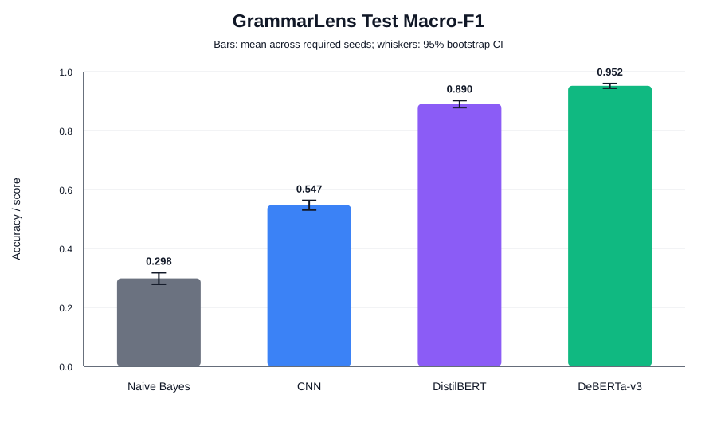
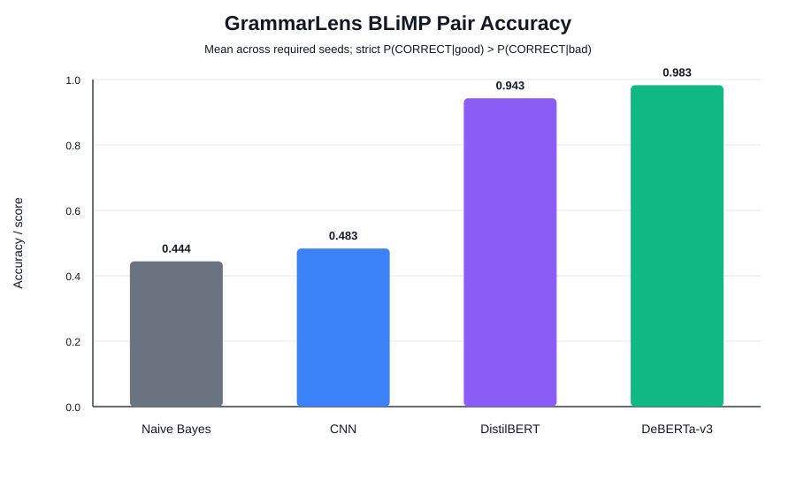

# GrammarLens

**English grammatical error-type classification on a self-built dataset.** Given a sentence,
predict which of six grammatical error types it contains — or that it is correct. The dataset is
built from real web English (UD English-EWT) with our own cleaning and single-error injection
script, and the model ladder runs from Naive Bayes to DeBERTa-v3.

**COE025 Natural Language Processing — Project 1 (Text Classification), İstinye University**  
**Team:** Mert Tomak · Görkem Veysel Göksu · Zeynep Çelik · Cemal Batuhan Baş · Yağız Efe Gökçe
(roles and contribution files: [Team](#team))

| Model | Role | Macro-F1 (test) | 95% CI | Accuracy | BLiMP pair acc. | BLiMP type acc. |
|---|---|---:|---:|---:|---:|---:|
| Naive Bayes | baseline | 0.298 | 0.279–0.318 | 0.310 | 0.444 | 0.268 |
| CNN | baseline | 0.547 ± 0.009 | 0.530–0.563 | 0.550 | 0.483 | 0.248 |
| DistilBERT | baseline | 0.890 ± 0.002 | 0.878–0.902 | 0.892 | 0.943 | 0.904 |
| **DeBERTa-v3** | **new method** | **0.952 ± 0.001** | 0.944–0.960 | 0.952 | **0.983** | **0.960** |

Test split: 2,114 sentences (7 classes × 302). Neural models: mean ± population std over seeds
13 / 42 / 2026; CI = 95% bootstrap of the seed mean. Every number comes from
`results/benchmark.csv`, which `src/build_benchmark.py` recomputes from the stored predictions.

## Why it is novel

- **Task.** Grammatical error *type* classification is not one of the text-classification tasks
  covered in the course (sentiment, spam, topic, intent, content moderation, authorship, medical,
  legal, emotion). It needs syntax — agreement, verb forms, word order — not topic words.
- **Data.** Our own dataset, built from the raw UD English-EWT treebank with our own cleaning and
  error-injection script. It is not a ready-made Kaggle or Hugging Face dataset, it is not tiny
  (20,300 labeled examples), and it is fully reproducible: the raw files are pinned and
  checksummed, and rebuilding reproduces `data/processed/` byte for byte.

## The task

7-way, single-label classification. One class is clean text; the six others are error types, each
produced by exactly one scripted edit of a real sentence:

| Class | Error | Example from the data |
|---|---|---|
| `CORRECT` | none | I am a preferred provider with most insurance companies. |
| `SVA` | subject–verb disagreement | He **are** concerned about the allocation … |
| `VERB_FORM` | wrong verb form | I want to **went** all over … |
| `DET` | article error (a/an deleted or swapped) | I recently took **an** rescue puppy … |
| `NOUN_NUM` | singular/plural mismatch | We are planning **this events** for Thursday … |
| `PREP` | wrong preposition | … being given directly **with** John … |
| `WORD_ORDER` | two adjacent words swapped | Later they kept the same name for **company the**. |

A `WORD_ORDER` sentence has the same bag of words as its correct version (true for 2,899 of the
2,900 `WORD_ORDER` examples), so a pure word-counting model cannot see it. That is the point of
the model ladder: each rung adds one capability.

## Dataset: GrammarLens-EWT

Full documentation with every number and rule: **[docs/preprocessing.md](docs/preprocessing.md)**.

1. **Source** — [UD English-EWT](https://github.com/UniversalDependencies/UD_English-EWT)
   (commit `4a4d77f`), 16,622 real web sentences with gold POS, lemma and dependency annotation.
2. **Cleaning** — 6 ordered rules drop 6,488 sentences (annotated typos 1,347 · length 3,438 ·
   links/e-mail 209 · all-caps 130 · no finite verb 1,127 · duplicates 237); 10,134 remain.
   Duplicates are dropped *across* splits, so no sentence appears in both train and test.
3. **Error injection** — errors are generated from the gold annotation: exactly one edit per
   sentence and type; if the sentence has no suitable spot, that type is skipped. Deterministic
   (`seed=42`).
4. **Split and balancing** — EWT's own train/dev/test split is kept, and all versions of a
   sentence stay in the same split (checked: 0 shared `sent_id` between train and test). Inside
   each split all 7 classes are downsampled to the smallest class. Final: **20,300 examples** —
   train 16,009 (78.9%), dev 2,177 (10.7%), test 2,114 (10.4%); per class 2,287 / 311 / 302.

Label quality was audited by hand: 140 sampled test examples → 3 wrong labels (2.1%). A
model-driven review found more noise concentrated in `PREP` and `DET` (see
[results/error_analysis.md](results/error_analysis.md) and preprocessing.md §5).

## Models

| Model | Role | Architecture | Specific model | Pre-trained | Params | Hardware · time per run |
|---|---|---|---|---|---:|---|
| Naive Bayes (`src/train_nb.py`) | baseline | bag of words + multinomial Naive Bayes | lowercase unigram counts, `MultinomialNB` (α = 1.0) | no | — | CPU · 0.3 s |
| CNN (`src/train_cnn.py`) | baseline | convolutional network for text (Kim, 2014) | TextCNN: 100-d embeddings, windows 3/4/5 × 100 filters, max-pool, dropout 0.5 | no | — | Tesla T4 · ~51 s |
| DistilBERT (`src/train_transformer.py`) | baseline | Transformer encoder (BERT) | `distilbert-base-uncased`, 6 layers | yes | 67M | RTX 4070 Laptop · 149–181 s |
| **DeBERTa-v3** (`src/train_transformer.py`) | **new method** | Transformer encoder with disentangled attention (DeBERTa) | `microsoft/deberta-v3-base`, 12 layers | yes | 184M | RTX 4070 Laptop · 447–668 s |

**Baseline vs new method.** Naive Bayes, CNNs and BERT-style models (DistilBERT is the course's
recommended BERT variant) are covered in the lectures in their vanilla form, so they are our
baselines. DeBERTa-v3 is not covered in the course; it is our new method.

**Architecture vs model.** An *architecture* is the network design: the Transformer encoder is
the architecture of both DistilBERT and DeBERTa-v3. A *model* is one trained instance of an
architecture with a specific size, pre-training data and pre-training objective:
`distilbert-base-uncased` is a 6-layer BERT distilled from BERT-base; `deberta-v3-base` is a
12-layer DeBERTa that encodes word content and position in separate vectors (disentangled
attention with relative positions) and is pre-trained ELECTRA-style (replaced-token detection).
Both Transformers are fine-tuned by the **same script** — only the checkpoint name and the default
learning rate differ — so the difference between them comes from the model, not from the code.

**Training settings.** CNN: Adam 1e-3, batch 64, vocabulary from train only (min frequency 2),
up to 30 epochs. Transformers: AdamW (weight decay 0.01), lr 3e-5 (DistilBERT) / 2e-5
(DeBERTa-v3), 10% linear warmup then linear decay, batch 32, max 64 tokens (no sentence is
truncated), 3 epochs, gradient clipping 1.0, bf16 autocast with fp32 weights. For every neural
model the epoch with the best dev macro-F1 is kept. No hyperparameter search was done, and all
choices used the dev split only.

## Evaluation

- **Why macro-F1.** Every error type is equally important, so the main metric must weight each
  class equally. The raw class distribution is skewed (train before balancing: `CORRECT` 7,960
  vs `NOUN_NUM` 2,287), so we balanced every split. On a balanced, single-label test set
  accuracy equals macro recall (and micro-F1 equals accuracy), so accuracy alone would hide
  per-class precision problems — for example a model that flags many correct sentences as
  errors. Macro-F1 averages the per-class F1 scores, so it rewards only models that are good at
  *every* type, and it stays meaningful if the class balance changes. AUC was not used: our
  decisions are hard labels, and the probability ranking is tested separately by BLiMP pair
  accuracy. Accuracy, macro precision, macro recall, per-class F1 and the confusion matrix are
  reported as well (`results/*_seed*.json`).
- **Protocol.** The test split is read only in final runs (`--final`), after all choices were
  made on dev. Neural models are trained with three seeds (13, 42, 2026); Naive Bayes is
  deterministic and trained once. We report mean ± population standard deviation over seeds and a
  95% bootstrap confidence interval (1,000 resamples) of the seed mean. Neural training is
  deterministic per seed: re-running a seed reproduces the same dev scores.
- **External test (BLiMP).** 14,000 hand-built minimal pairs from 14 pinned BLiMP files
  (6,000 subject–verb, 8,000 determiner–noun agreement). *Pair accuracy*: the grammatical
  sentence gets the higher `CORRECT` probability (chance 0.50). *Type accuracy*: the
  ungrammatical sentence is classified as the expected error type (chance ≈ 0.14). This tests
  whether a model learned grammar or only our injection style.

## Results




**Reading the two figures.** They answer different questions on different data:

| | Macro-F1 (top) | BLiMP pair accuracy (bottom) |
|---|---|---|
| Data | our test split (2,114 sentences) | 14,000 external minimal pairs (BLiMP) |
| Question | which of the 7 classes is this sentence? | which of these two sentences is grammatical? |
| How | one predicted label per sentence | the good sentence must get a strictly higher `CORRECT` probability than the bad one (a tie counts as a failure) |
| Classes covered | all 7 | only `SVA` and `NOUN_NUM` |
| Chance level | ≈ 0.14 | 0.50 |
| What it shows | performance on our task | whether the model learned grammar or only our injection style |

- The Transformers score *higher* on BLiMP than on our test split because BLiMP only tests `SVA`
  and `NOUN_NUM`, their strongest classes (F1 0.94–0.99), and choosing the better of two
  sentences is easier than naming one of seven classes.
- Naive Bayes and the CNN look higher on BLiMP (0.44 / 0.48) than on macro-F1, but their chance
  level there is 0.50, so they are **at or below chance**: they cannot tell the grammatical
  sentence of a pair from the ungrammatical one.
- **Why the CNN fails on BLiMP although it learned our task (0.547 macro-F1).** (1) It has no
  pre-training: it learned from 16,009 training sentences only, and its vocabulary is word-level
  and built from the train split (words seen fewer than 2 times become `<unk>`). BLiMP is built
  from templates with many words that never occur in our web data; when the one word that differs
  inside a pair is unknown, both sentences become the same input, get the same probability, and
  the pair counts as a failure. The Transformers use subword tokenizers, so every word is visible
  to them. (2) Pair accuracy depends on the `CORRECT` probability, and `CORRECT` is the CNN's
  weakest class (F1 0.339). (3) The CNN fitted the patterns of our injected errors without
  learning agreement in general; the pre-trained Transformers transfer to the new sentences.

**Per-class F1 on the test split** (mean over seeds):

| Class | Naive Bayes | CNN | DistilBERT | DeBERTa-v3 |
|---|---:|---:|---:|---:|
| `CORRECT` | 0.127 | 0.339 | 0.720 | 0.873 |
| `SVA` | 0.345 | 0.618 | 0.943 | 0.978 |
| `VERB_FORM` | 0.349 | 0.599 | 0.975 | 0.986 |
| `DET` | 0.399 | 0.533 | 0.878 | 0.931 |
| `NOUN_NUM` | 0.422 | 0.662 | 0.988 | 0.993 |
| `PREP` | 0.250 | 0.419 | 0.772 | 0.922 |
| `WORD_ORDER` | 0.197 | 0.660 | 0.958 | 0.980 |

**Confusion matrix of DeBERTa-v3** (seed 42; rows = true label, columns = prediction; 2,013 of
2,114 correct). Most errors sit between `CORRECT` and `PREP`/`DET` — see the error analysis below.

| true \ pred | CORRECT | SVA | VERB_FORM | DET | NOUN_NUM | PREP | WORD_ORDER |
|---|---:|---:|---:|---:|---:|---:|---:|
| `CORRECT` | **270** | 5 | 2 | 14 | 0 | 7 | 4 |
| `SVA` | 3 | **297** | 0 | 0 | 0 | 1 | 1 |
| `VERB_FORM` | 1 | 0 | **300** | 1 | 0 | 0 | 0 |
| `DET` | 13 | 1 | 4 | **281** | 0 | 2 | 1 |
| `NOUN_NUM` | 0 | 0 | 0 | 1 | **298** | 1 | 2 |
| `PREP` | 24 | 2 | 0 | 5 | 1 | **269** | 1 |
| `WORD_ORDER` | 1 | 0 | 1 | 1 | 0 | 1 | **298** |

**What each rung adds.**

- **Word order (NB → CNN).** Naive Bayes only counts words, so `WORD_ORDER` stays at 0.197 F1.
  The CNN sees 3–5-word windows and reaches 0.660 on it; macro-F1 rises from 0.298 to 0.547.
- **The CNN's window limit.** On `SVA` sentences, the CNN's error rate is 0.34–0.38 when subject
  and verb fit in one 5-word window and 0.62–0.77 when 4 or more words lie between them
  (`src/analyze_long_distance.py`; only 13 sentences are that far apart, so this is a small,
  correlational result).
- **Pre-training (CNN → DistilBERT).** Macro-F1 rises to 0.890. On BLiMP, the models trained
  from scratch stay at or below chance on pair accuracy (0.44 / 0.48), while the pre-trained
  Transformers reach 0.94 / 0.98 — they did not just fit our injection style.
- **A stronger model (DistilBERT → DeBERTa-v3).** +0.062 macro-F1, with non-overlapping
  confidence intervals. The largest gains are on `CORRECT` (+0.153) and `PREP` (+0.150), the
  classes that need sentence meaning rather than the form of one word; BLiMP `SVA` type accuracy
  rises from 0.839 to 0.955.

## Error analysis: why 0.952 is likely pessimistic

DeBERTa-v3 (seed 42) makes 101 test errors; 74 involve `CORRECT`. We re-read the three largest
confusions ([results/error_analysis.md](results/error_analysis.md)):

- `PREP → CORRECT` (24): 13 swapped sentences are still grammatical, 3 more probably fine —
  only 2 are real model misses.
- `DET → CORRECT` (13): 8 remain acceptable after the article edit.
- `CORRECT → DET` (14): in 10 the *original* web text already contains an article error
  (e.g. "a ebook") — the model is right, the label is wrong.

So a visible share of the remaining "errors" is label noise, not model failure, and the reported
macro-F1 is likely somewhat pessimistic. The reviewed sentences were selected because the model
got them wrong, so they give a lower bound on the noise, not a noise rate. Suggested fix (not
done here): filter injected sentences that remain acceptable and drop originals with article
errors.

## Limitations

- The errors are injected by a script, not written by real learners; real errors are more
  diverse.
- Every sentence contains at most one error; sentences with several errors were not tested.
- `PREP` and `DET` contain label noise, and `CORRECT` contains some original web text with
  article errors (see the error analysis above).
- BLiMP covers only `SVA` and `NOUN_NUM`, and our pair/type accuracy is an adaptation of BLiMP
  to a classifier (the original BLiMP compares language-model sentence probabilities).
- No hyperparameter search was done. The CNN's best epoch was its last (30) for all seeds, so it
  may be slightly under-trained (see Zeynep's contribution file).
- Training times come from two different GPUs (Tesla T4 for the CNN, RTX 4070 Laptop for the
  Transformers) and are only a rough guide.

## Repository structure

```
README.md                this file
LICENSE                  MIT for code + data licenses (CC BY-SA 4.0 / CC BY 4.0)
requirements.txt         Python dependencies
data/
  raw/UD_English-EWT/    pinned, unmodified EWT treebank (3 .conllu files + license)
  raw/blimp/             14 pinned, unmodified BLiMP files used as the external test
  raw/checksums.txt      SHA-256 of every raw file
  processed/             the built dataset: train/dev/test.csv + stats.json
                         (columns: id, sent_id, label, text, source)
docs/
  preprocessing.md       full dataset-construction documentation
scripts/
  download_data.py       downloads the pinned raw files and writes checksums.txt
  build_dataset.py       cleaning → error injection → balancing → processed CSVs
src/
  metrics.py             shared metrics (macro-F1, per-class F1, confusion matrix) + result writers
  evaluate_blimp.py      BLiMP minimal-pair evaluation (pair + type accuracy)
  train_nb.py            trains/evaluates the Naive Bayes baseline
  train_cnn.py           trains/evaluates the CNN baseline
  train_transformer.py   fine-tunes DistilBERT or DeBERTa-v3 (same script)
  build_benchmark.py     validates all runs, writes results/benchmark.csv + figures
  analyze_long_distance.py  CNN SVA error rate vs. subject–verb distance (prints only)
results/
  <model>_seed<seed>.json  per-run test metrics, BLiMP scores, hardware, training time
  preds/                 id,label,pred for every final run (2,114 rows each)
  benchmark.csv          official aggregated table
  figures/               benchmark charts (SVG)
  label_audit.csv        manual label-quality audit of 140 sampled test examples
  error_analysis.md      DeBERTa-v3 error analysis + label-noise findings
contributions/           per-member contribution reports
```

## Reproducing

```bash
# 1. Install the CUDA build of PyTorch first: https://pytorch.org/get-started/locally/
pip install -r requirements.txt

# 2. Data (the raw and processed data are already in the repository; this rebuilds them)
python scripts/download_data.py        # downloads the pinned raw files, writes checksums.txt
(cd data/raw && sha256sum -c checksums.txt)   # verify (macOS: shasum -a 256 -c checksums.txt)
python scripts/build_dataset.py        # → data/processed/ (10,134 clean sentences, 20,300 examples)

# 3. Final runs (without --final the scripts use train/dev only and write nothing)
python src/train_nb.py --final
for seed in 13 42 2026; do
  python src/train_cnn.py --final --seed $seed
  python src/train_transformer.py --model distilbert --final --seed $seed
  python src/train_transformer.py --model deberta-v3 --final --seed $seed
done

# 4. Benchmark and analysis
python src/build_benchmark.py          # validates every run, writes benchmark.csv + figures
python src/analyze_long_distance.py    # prints the CNN distance analysis (writes nothing)
```

## Licenses

See **[LICENSE](LICENSE)** for the full text.

- **Code and documentation** (`src/`, `scripts/`, `docs/`): MIT License.
- **`data/raw/UD_English-EWT/`** and the derived dataset in **`data/processed/`** (and the
  results files that quote its sentences): CC BY-SA 4.0 — ShareAlike carries over to the
  derived dataset.
- **`data/raw/blimp/`**: CC BY 4.0.
- Raw files are unmodified, pinned by commit and verified via `data/raw/checksums.txt`.

## Citations

- Silveira et al. (2014). *A Gold Standard Dependency Corpus for English.* LREC.
- Warstadt et al. (2020). *BLiMP: The Benchmark of Linguistic Minimal Pairs for English.* TACL.
- Kim (2014). *Convolutional Neural Networks for Sentence Classification.* EMNLP.
- Vaswani et al. (2017). *Attention Is All You Need.* NeurIPS.
- Devlin et al. (2019). *BERT: Pre-training of Deep Bidirectional Transformers for Language Understanding.* NAACL.
- Sanh et al. (2019). *DistilBERT, a distilled version of BERT: smaller, faster, cheaper and lighter.* arXiv:1910.01108.
- He et al. (2021). *DeBERTa: Decoding-enhanced BERT with Disentangled Attention.* ICLR.
- He et al. (2023). *DeBERTaV3: Improving DeBERTa using ELECTRA-Style Pre-Training with Gradient-Disentangled Embedding Sharing.* ICLR.

## Team

| Member | Role | Contribution file |
|---|---|---|
| Mert Tomak | data cleaning and preprocessing | [MERT_TOMAK_2409011055_MertTomak.md](contributions/MERT_TOMAK_2409011055_MertTomak.md) |
| Görkem Veysel Göksu | Naive Bayes, shared evaluation, benchmark | [GORKEM_VEYSEL_GOKSU_2309111084_GorkemGoksu.md](contributions/GORKEM_VEYSEL_GOKSU_2309111084_GorkemGoksu.md) |
| Zeynep Çelik | CNN model | [ZEYNEP_CELIK_2309111135_zeynepcelikx.md](contributions/ZEYNEP_CELIK_2309111135_zeynepcelikx.md) |
| Cemal Batuhan Baş | Transformer models (DistilBERT, DeBERTa-v3) | [CEMAL_BATUHAN_BAS_2309111036_BatuhanbasSwe.md](contributions/CEMAL_BATUHAN_BAS_2309111036_BatuhanbasSwe.md) |
| Yağız Efe Gökçe | README, documentation and presentation | [contributions/](contributions/) |
